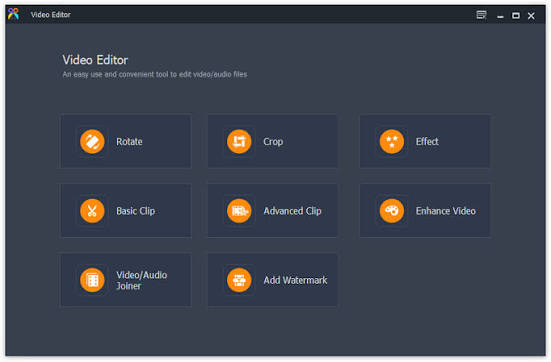
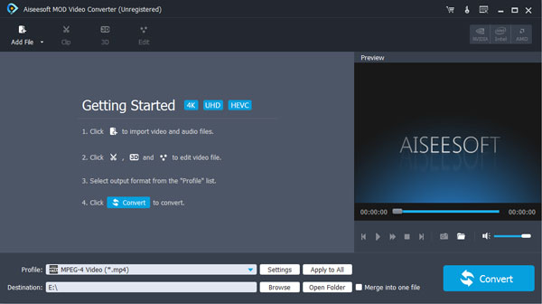
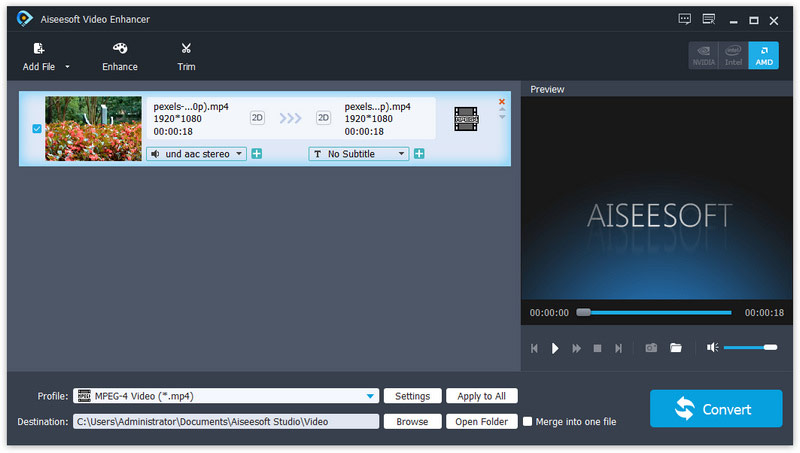

# Aiseesoft FoneLab: Three Routes to iPhone Data

Aiseesoft FoneLab examines an iOS device, a local iTunes backup, or data available through its iCloud recovery workflow.
The useful result is a selected photo, conversation, contact, or document that you can inspect and export.
Start by identifying where a usable copy might still exist.

## Match the Missing Item to Its Timeline

Write down when the item existed, when it disappeared, and which backups were made between those dates.
A backup made before a photo was taken cannot contain that photo.
A newer backup may also reflect a deletion that already happened.

Choose a source around that sequence:

- **The phone is available:** inspect the supported device categories.
- **An older computer backup exists:** compare its device identity and date with the missing item.
- **Relevant data is available in iCloud:** inspect the categories offered by the cloud recovery mode.
- **Several sources exist:** keep their results separate until you have compared them.

The [FoneLab recovery guide](https://www.aiseesoft.com/iphone-data-recovery/tutorial.html) describes all three routes.
These modes examine different sources; selecting another mode does not recreate content absent from that source.
Record the source beside each export so that an older copy is not confused with the current version.

[](https://fonelab-iphone-data-recovery.github.io/Aiseesoft-Fonelab/)

## Inspect a Local Backup Without Replacing Your Phone

In FoneLab, choose **Recover from iTunes Backup File** and select the relevant backup.
An encrypted backup requires its backup password.
After scanning, select the items to export to the computer rather than restoring the entire phone.

Keep the original backup intact and use a separate destination for recovered files.
A completed export is easier to assess when its source backup remains available.
Preserve the backup directory as a whole; the visible file names do not describe every stored document.

### Keep encryption and account access separate

A local backup password is distinct from the iPhone passcode and Apple Account password.
Apple explains the difference in its [encrypted backup documentation](https://support.apple.com/en-ie/108353).
Changing the password for future backups does not unlock an older encrypted backup.

For an existing copy, confirm:

1. The backup belongs to the intended device.
2. Its date fits the period you need.
3. Its encryption password is available when required.
4. The backup folder has not been reduced to a few selected files.
5. There is enough space for a separate export.

### Create a separate current snapshot with libimobiledevice

When preserving the phone's present state is useful, libimobiledevice provides a backup command.
This Bash example assumes the tools are installed, one trusted device is connected, and the destination name is unused.
Keep this current snapshot separate from older backups needed for recovery.

```bash
mkdir "./iphone-current-snapshot"
idevicebackup2 backup --full "./iphone-current-snapshot"
```

The command is documented in [idevicebackup2.1](docs/idevicebackup2.1).
Its service bindings are in [mobilebackup2.pxi](cython/mobilebackup2.pxi).
The earlier backup interface is documented separately in [idevicebackup.1](docs/idevicebackup.1) and [mobilebackup.pxi](cython/mobilebackup.pxi).
A new snapshot preserves what the backup service includes now; it cannot stand in for a missing historical copy.

### Read a backup's identity before reviewing its contents

For an actual backup containing an Info.plist file, Python's standard library can read its metadata.
Replace the example directory with the device-specific backup directory you want to inspect.

```python
from pathlib import Path
import plistlib

info_path = Path("backup-to-review") / "Info.plist"
with info_path.open("rb") as source:
    info = plistlib.load(source)
for field in ("Device Name", "Product Version", "Last Backup Date"):
    print(f"{field}: {info.get(field, 'not recorded')}")
```

Python documents this reader in [plistlib](https://docs.python.org/3/library/plistlib.html).
Missing metadata is a reason to inspect the backup further, not proof that it contains no useful data.
For the separate device-library interface, [imobiledevice.pxd](cython/imobiledevice.pxd) holds Cython declarations and [imobiledevice.pyx](cython/imobiledevice.pyx) implements shared binding behavior.

## Judge the Preview by Content, Not by Item Count

A large scan result does not answer whether the particular item you need is present.
In FoneLab, inspect the relevant category and open representative results before selecting a batch.
The [product overview](https://www.aiseesoft.com/iphone-data-recovery/) describes preview and selective recovery.



Use a specific acceptance check for each kind of result:

| Item being reviewed | Identity check | Completeness check | Reason to inspect another source |
| --- | --- | --- | --- |
| Photo | Subject and approximate capture date | Useful image detail at normal viewing size | Only a small thumbnail is present |
| Message thread | Participants and date range | Needed messages and available attachments | The important exchange predates this backup |
| Contact | Person and phone number | Required email addresses and additional fields | The record is an older version |
| Voice memo | Name and recording context | Playback and expected duration | The recording is missing or incomplete |
| Note | Title and recognizable text | Needed paragraphs and available attachments | The preview shows only part of the material |

Export a small representative selection first.
Open the resulting files in their normal desktop applications.
Then expand the selection if the result meets the purpose of the recovery.

### Locate photo entries in a readable backup manifest

A local iOS backup can use a Manifest.db database to map logical paths to stored files.
For an unencrypted or separately decrypted manifest opened in a SQLite viewer, this query lists a small set of camera-roll entries.

```sql
SELECT fileID, domain, relativePath
FROM Files
WHERE domain = 'CameraRollDomain'
  AND relativePath LIKE 'Media/DCIM/%'
ORDER BY relativePath
LIMIT 12;
```

The query lists references; it does not extract images.
An encrypted manifest must be made readable using the backup password before SQLite can interpret it.
The [iphone-backup-decrypt usage documentation](https://github.com/jsharkey13/iphone_backup_decrypt#usage) explains manifest inspection and password-based extraction.

For device-side file access, libimobiledevice documents AFC and House Arrest in [afcclient.1](docs/afcclient.1).
The corresponding bindings are [afc.pxi](cython/afc.pxi) and [house_arrest.pxi](cython/house_arrest.pxi).
The [file_relay.pxi](cython/file_relay.pxi) binding describes another device service; it is not the backup manifest.

## Scan the Available iPhone Through Its Normal Trust Relationship

Use FoneLab's **Recover from iOS Device** mode when the phone can connect to the computer.
Connect it by USB, unlock it when required, and respond to the device's trust prompt.
Then choose the categories relevant to the missing material and start the scan.

Device detection is only the first checkpoint.
The software must still access a supported category, complete its scan, and produce a useful preview.
A connected phone does not guarantee that every deleted item remains recoverable.



Check the [supported devices and data matrix](https://www.aiseesoft.com/iphone-data-recovery/reference.html) for the actual model and recovery mode.
The matrix distinguishes text and media support and includes model-dependent photo limitations.
A thumbnail and an original-resolution photograph are different outcomes.

Libimobiledevice provides separate references for connection identity:

- [idevice_id.1](docs/idevice_id.1) explains how attached devices are identified.
- [ideviceinfo.1](docs/ideviceinfo.1) documents device information queries.
- [idevicename.1](docs/idevicename.1) documents reading or changing the device name.
- [idevicepair.1](docs/idevicepair.1) describes host pairing management.

Its [lockdown.pxi](cython/lockdown.pxi) binding covers the connection-management service.
Host preference and pairing-related helpers are declared in [userpref.h](common/userpref.h) and implemented in [userpref.c](common/userpref.c).
These references help distinguish device recognition from access to the data you want.

If the phone cannot complete the required authorization, inspect an existing backup as a separate source.
Do not assume a scanning mode can bypass the normal device trust requirements.

## Review Cloud Categories as Their Own Source

FoneLab's **Recover from iCloud** workflow uses account authentication and any required verification step.
Choose from the data categories offered in the current interface.
The official guide shows categories such as contacts, notes, reminders, photos, and attachments.

Cloud availability is not the same thing as local backup availability.
Compare the actual result with the missing item's date and content.
Do not assume that a category shown in the interface contains every historical version.



Keep cloud exports in a separate folder from device-scan and local-backup exports.
If two sources contain the same photo or contact, compare them before choosing which copy to retain.
Record which source supplied an attachment when the associated message or note is incomplete elsewhere.

The supplied libimobiledevice materials also distinguish several local device services:
[mobilesync.pxi](cython/mobilesync.pxi) binds MobileSync, while [notification_proxy.pxi](cython/notification_proxy.pxi) binds the device notification service.
The latter's command-line utility is documented in [idevicenotificationproxy.1](docs/idevicenotificationproxy.1).
These interfaces concern device communication, not access to an iCloud account.

## Define the Result Before Closing the Recovery Session

Keep the source identifier, selected category, export location, and any missing content in a short recovery record.
For photos, note whether you recovered originals or only smaller representations.
For conversations, record the useful date range and whether attachments were included.
For contacts, check the fields you need before importing anything into another address book.

A scan result, an exported file, and a restored phone are three different results.
Choose the result needed for the task before repeating a scan or switching tools.

**Fonelab Iphone Data Recovery** is the recovery-focused product covered here.
Within the wider **aiseesoft software** catalog, **Aiseesoft Fonelab** should not be confused with every other mobile utility.
The related **aiseesoft fonetrans** product handles device file transfers, as its [official transfer guide](https://www.aiseesoft.com/thankyou/install-fonetrans.html) shows.
The broader **aiseesoft studio** search phrase also covers products outside this recovery workflow.

For a failed session, record the operating system, FoneLab version, recovery mode, device model, and exact error.
Use the [FoneLab FAQ](https://www.aiseesoft.com/iphone-data-recovery/faq.html) to narrow the relevant product question.
Avoid including personal messages, account passwords, or full backup contents in a public issue.

For libimobiledevice troubleshooting, [idevicesyslog.1](docs/idevicesyslog.1) documents system-log relay and [idevicecrashreport.1](docs/idevicecrashreport.1) documents crash-report retrieval.
The shared debugging declarations are in [debug.h](common/debug.h).
Licensing terms for the library are supplied in [COPYING.LESSER](COPYING.LESSER).

## Related Search Terms

Fonelab Iphone Data Recovery, Aiseesoft Fonelab, aiseesoft studio, aiseesoft software, aiseesoft fonetrans, ios, iphone, ipados, backup, ios-backup, backup-extractor, backup-viewer, encrypted-backups, itunes, decryption
